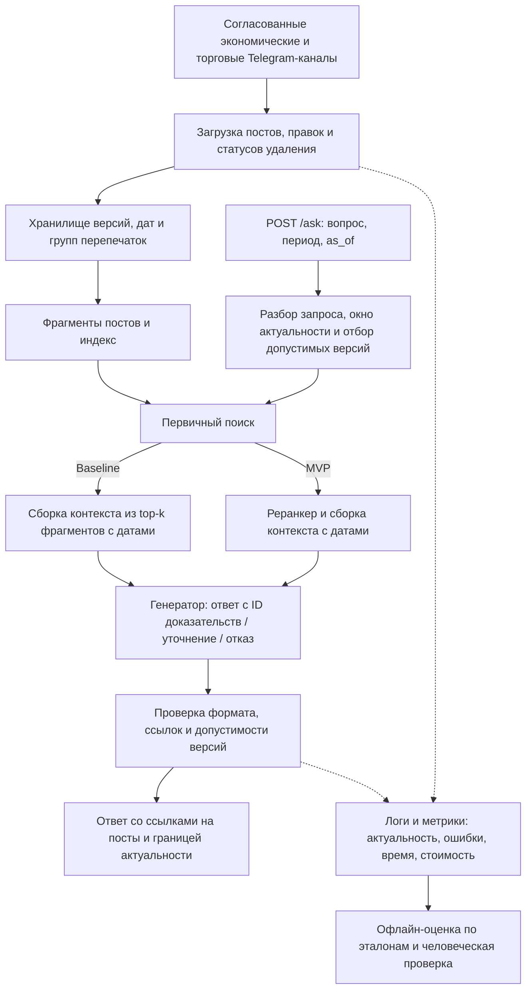

# ML System Design Doc: новостной RAG-ассистент по Telegram-каналам

## 1. Цели и предпосылки

### 1.1. Зачем идем в разработку продукта?

**Пользователи:** читатели экономических и торговых Telegram-каналов, которым
нужно проверить конкретный факт; аналитики, сотрудники компаний и журналисты,
которые готовят справки. Основная группа — люди, регулярно решающие такие
задачи.

**Проблема:** поиск по нескольким каналам, сопоставление публикаций и проверка
актуальности выполняются вручную. Перепечатки, исправления и неподтверждённые
заявления затрудняют подготовку ответа.

**Бизнес-цель:** сократить время получения проверенной фактической справки.
RAG должен находить доказательства в выбранных каналах и собирать понятный
ответ со ссылками. Экономия пользовательского времени остаётся гипотезой;
в этой итерации проверяется качество ответа по заданным критериям.

**Успех итерации:** ответы проходят офлайн-валидацию на отложенном наборе
вопросов: корректны, подтверждены источниками, актуальны и сохраняют важные
оговорки. Задержка и стоимость измеряются отдельно. Сравнение скорости работы
пользователей с обычным поиском в эту итерацию не входит.

### 1.2. Бизнес-требования и ограничения

**Сценарий:** пользователь спрашивает: «Какие предварительные результаты компания
опубликовала за сентябрь и что было известно на 1 октября?» Ассистент учитывает
временные ограничения и возвращает ответ, источники, даты и существенные оговорки.

| ID | Требование | Проверка |
| --- | --- | --- |
| BR-1 | Отвечать на фактические вопросы по экономическим и торговым новостям понятным языком | Набор целевых вопросов и ручная оценка по критериям §3.1 |
| BR-2 | Сохранять числа, единицы, сущности, периоды, условия и статус предварительных значений | Сверка обязательных фактов с эталонной разметкой |
| BR-3 | Подкреплять существенные утверждения ссылками на конкретные посты | Проверка связок «утверждение — доказательство» |
| BR-4 | Не использовать сведения, недоступные на заданный момент; показывать границу актуальности | Исторические сценарии с поздними публикациями и правками |
| BR-5 | Учитывать доступные исправления, сохранять атрибуцию заявлений и показывать противоречия | Сценарии с обновлениями, слухами и перепечатками |
| BR-6 | Уточнять неоднозначный вопрос или сообщать о недостатке доказательств | Неоднозначные и неответимые вопросы; отдельный учёт ошибочных отказов |
| BR-7 | Для запросов о текущей ситуации выдавать новости в допустимом окне актуальности; не подменять свежие сведения устаревшими | Сценарии со свежими и старыми постами, перепечаткой старого события и отсутствием свежих данных |

**Временная семантика:** период интересующих событий или публикаций и момент
доступного знания задаются отдельно. Если смысл периода неясен, система
уточняет его. По умолчанию момент — время запроса. Сентябрьская новость,
опубликованная в ноябре, недопустима для ответа «что было известно на 1 октября».
Нынешний текст отредактированного поста не подменяет его историческую версию.
«Последнее известное» означает последнее в доступных источниках с указанием
свежести корпуса.

**Актуальность:** для текущих запросов поиск ограничен периодом пользователя
или окном актуальности по умолчанию. Размер окна задаётся в конфигурации
и фиксируется после baseline с учётом типа новостей. Учитываются дата публикации,
дата события при наличии и более поздние исправления: свежая перепечатка
не делает старое событие новым. Если свежих доказательств нет или обновление
корпуса просрочено, ассистент сообщает об ограничении и не выдаёт старую новость
за текущую. Для исторических запросов действуют заданный период.

| Ограничение | План первой итерации |
| --- | --- |
| Данные | 2–3 согласованных канала; ориентир — 1–3 тыс. текстовых постов за 30–90 дней |
| Обновление | Пакетная загрузка раз в сутки; ориентир отставания индекса — до 24 ч |
| Язык и нагрузка | Русский язык, один одновременный запрос на стенде MVP |
| Ресурсы | Один стенд; Модели выбираются после baseline |
| Задержка и стоимость | Начальный ориентир p95 — до 20 с; предел стоимости запроса фиксируется после baseline |
| Бюджет | Платные вызовы моделей — после согласования бюджета |
 |

### 1.3. Что входит в скоуп проекта/итерации, что не входит

**MVP закрывает BR-1…BR-7:** загрузка и обновление текстовых постов, версии,
дедупликация, временные фильтры, первичный поиск, реранкер, сборка контекста,
генератор, проверки ссылок и версий, простой API, логи, мониторинг и офлайн-оценка.

**За пределами MVP:** дополнительные эксперименты из §2.3,
агенты, обучение моделей, многотуровой диалог, персональная лента,
обработка комментариев/аудио/видео/изображений, прогнозы, торговые операции,
высокая нагрузка и production-SLA.

**Технический долг:** ручной отбор источников и части разметки, один стенд,
пакетное обновление, отсутствие отказоустойчивости и автоматического переобучения.

### 1.4. Предпосылки решения

| Предпосылка | Обоснование и способ проверки |
| --- | --- |
| Допустим сбор и использование выбранных публикаций для RAG и оценки | Проверить условия платформы, источников и необходимые согласия до сбора |
| Посты содержат достаточно текста, дат и ссылок | Проверить на небольшом корпусе |
| Значимая часть вопросов решается по нескольким публикациям | Вручную разобрать примеры до выбора моделей |
| Перепечатки можно выделять в группы | Проверить дубли на примерах; копии одного сообщения не считать независимыми доказательствами |
| Доступна независимая разметка | Основную разметку готовит разработчик, часть набора проверяет второй человек |

Способ получения данных: парсинг текстовых данных через API.

Единица данных — **версия поста**, единица поиска — фрагмент с привязкой к посту,
единица оценки — вопрос и существенные утверждения ответа.
Точный поддомен новостей уточняется при выборе каналов.

## 2. Методология

### 2.1. Постановка задачи

Задача — информационный поиск и генерация фактического ответа по доказательствам
из выбранного корпуса Telegram-публикаций.

**Вход API `POST /ask`:** вопрос, необязательный период и его тип, актуальная дата.
Даты нормализуются в UTC, часовой пояс вопроса учитывается явно.
**Выход:** ответ / уточнение / недостаток данных, доказательства и ссылки,
даты, граница актуальности и `request_id`. Идентификатор среза корпуса
сохраняется для воспроизведения запроса.

**Baseline:** BM25 с временными фильтрами, сборка контекста из top-k фрагментов
и готовая LLM. Это минимальное решение для первых измерений качества и затрат.
**MVP:** тот же конвейер с готовым реранкером перед сборкой контекста. Его пользу
проверяют относительно baseline при фиксированном генераторе и срезе данных.
Эмбеддинги и гибридный поиск рассматриваются после анализа ошибок поиска.

### 2.2. Блок-схема решения

Общая схема показывает baseline и добавление реранкера в MVP.

URL формируются сервером из сохранённых источников. Проверки структуры и ссылок
не гарантируют правильность текста. Тексты источников трактуются как данные;
инструкции внутри них не должны управлять системой.

### 2.3. Этапы решения задачи

| Этап | Техника и ожидаемый результат |
| --- | --- |
| Данные и EDA | Проверить доступ, даты, долю дублей/правок, длины и покрытие тем. Получить корпус, схему версий и перечень ограничений |
| Baseline | Реализовать версии, временной отбор, BM25 (или Hybrid) и генератор. Получить воспроизводимые ответы и первые измерения |
| MVP | Добавить реранкер и проверить его вклад при фиксированных остальных компонентах |
| Офлайн-валидация | Проверить baseline и MVP на одинаковых закрытых вопросах по критериям §3.1 и разобрать ошибки |
| Стенд MVP | Подключить API и мониторинг, измерить задержку и стоимость, подготовить отчёт о качестве и ограничениях |

**Данные.** Для версии хранятся `channel_id`, `message_id`, URL, текст,
`published_at`, `edited_at`, `fetched_at`, `first_seen_at`, хеш, `version_id`,
ссылка на предыдущую версию и статус удаления. Фрагменты сохраняют координаты
в исходном тексте. Сырые данные, сессии и ключи не публикуются в репозитории.
На текущем этапе корпус и эталонная разметка отсутствуют; их собирают автор
и второй проверяющий. Обучение моделей для MVP не требуется.

**Версии и время.** Допускаются только доказательства, доступные к `as_of`.
Нужна подтверждённая дата доступности именно используемой версии; если её нет,
консервативная граница — первое наблюдение этой версии системой. Исходная дата
поста не доказывает доступность нынешнего текста в прошлом. Без подтверждённой
исторической версии доказательство исключается; при нехватке данных — отказ
от соответствующего вывода. Удалённые посты исключаются из текущей выдачи;
хранение истории ограничено условиями доступа. Перепечатки группируются,
исправления и конфликтующие сведения сохраняются раздельно.

**Выборки.** Собирается набор вопросов о числах, периодах, последних сведениях,
исправлениях, противоречиях и нехватке доказательств. Отдельно проверяются
устаревшие новости, свежие перепечатки старых событий и отсутствие свежих данных.
Эталон содержит обязательные
факты, допустимый ответ/отказ и подтверждающие версии источников. Development
используется для настройки; закрытый test — для итоговой оценки. Перефразировки,
версии постов и перепечатки одного события не разделяются между выборками.
По возможности test относится к более позднему периоду. Размер набора уточняется
после EDA; вопросы составляются по корпусу и целевым сценариям. Проверка
на реальных пользовательских запросах остаётся возможным следующим этапом.

**Сравнение конфигураций** проводится офлайн на одинаковых вопросах и срезах
Telegram, с фиксированными генератором и промптами. Результаты разбираются отдельно
для текущих и исторических вопросов. Интервалы неопределённости учитывают семейства
вопросов; при недостатке данных улучшение не объявляется доказанным.

| Уровень | Метрики |
| --- | --- |
| Итоговое качество | Доля ответов, прошедших все применимые критерии §3.1; отдельно по типам вопросов |
| Поиск | Recall@k необходимых доказательств, качество порядка и полнота итогового контекста |
| Ответ | Фактическая/временная корректность, доля ответов с устаревшими сведениями вместо актуальных, полнота, точность и покрытие цитирования, правильные и ошибочные отказы |
| Эксплуатация | p50/p95 полной задержки, стоимость запроса, ошибки/таймауты API, отставание корпуса |

**Возможные эксперименты по улучшению качества:**

- **Веб-проверка:** сравнить базовый RAG и RAG с ограниченным поиском внешних
  доказательств; учесть временную допустимость источников, ошибки, задержку и стоимость.
- **LLM-судья:** проверить пользу офлайн-оценки ответов на независимой человеческой
  разметке и примерах с подмешанными ошибками; измерить пропуски и ложные тревоги.
- **Улучшение реранкера:** сравнить готовый реранкер с дообученным на предпочтениях
  между документами, сохранив первичный поиск и генератор неизменными.
- **DPO генератора:** проверить дообучение на парах предпочтительных и непредпочтительных
  ответов для одинаковых вопросов и контекста, сохранив поиск и реранкер неизменными.

Если обучающие предпочтения формирует LLM-судья, их надёжность предварительно
проверяется по человеческой разметке. Каждый компонент улучшается отдельно;
результат сравнивается с исходной конфигурацией на независимом отложенном наборе
по качеству ответов, задержке и стоимости.

## 3. Подготовка пилота

### 3.1. Способ оценки пилота

В этой итерации используется **офлайн-валидация ответов**, без набора
пользователей и сравнения времени подготовки справок. На закрытом наборе
запускаются baseline и MVP. Для вопроса заранее фиксируются обязательные факты,
доказательства, временные ограничения и допустимый ответ, уточнение или отказ.
Проверяется смысл ответа, а не буквальное совпадение с эталонным текстом.

| Критерий | Условие прохождения |
| --- | --- |
| Фактическая корректность | Верны числа, единицы, сущности, даты и периоды; нет выдуманных фактов |
| Подтверждённость | Существенные утверждения подкреплены конкретными постами; ссылки и версии допустимы, заявления точно атрибутированы |
| Актуальность и время | Соблюдены период и момент доступного знания, учтены исправления; старые сведения не выданы за текущие |
| Полнота | Сохранены обязательные факты, условия, оговорки и существенные противоречия |
| Ответ или отказ | При достаточных доказательствах дан ответ; при нехватке данных или неоднозначности — обоснованный отказ или уточнение |
| Понятность | Ответ относится к вопросу, понятен читателю и не содержит лишних рассуждений |

Каждый критерий получает «выполнен / не выполнен / неприменим».
Ответ считается приемлемым, если выполнены все применимые критерии. Ошибки в фактах, источниках и времени не компенсируются хорошим стилем. Отдельно учитываются ответы на разрешимые вопросы, корректные отказы и необоснованные отказы, чтобы отказ всем не улучшал итоговую оценку.

Идентификаторы ссылок и допустимость версий проверяются программно; смысл,
полнота и атрибуция — вручную по источникам. При возможности второй проверяющий
размечает часть ответов без названия конфигурации; разногласия разбираются.
Отсутствие независимой проверки явно указывается как ограничение.

### 3.2. Что считаем успешным пилотом

Успех проверки — достижение заранее зафиксированной доли приемлемых
ответов и порогов задержки/стоимости. Пороги и рубрика фиксируются после baseline
на development-наборе, до итогового теста. По каждому критерию и типу вопросов
показываются число примеров, доля прохождения и критические ошибки.
Реранкер включается в итоговую конфигурацию при измеримом улучшении относительно
baseline и приемлемых затратах. При недостатке данных выигрыш не объявляется
доказанным. Экономия пользовательского времени этой проверкой не подтверждается.

### 3.3. Подготовка пилота

Подготавливаются закрытый набор, рубрика, фиксированный срез корпуса и конфигурации,
а также отчёт с ответами, доказательствами, оценками и разбором ошибок. Настройка
по результатам закрытого теста не проводится; изменения проверяются на новом
отложенном наборе. Отдельно выполняются замеры задержки и стоимости на стенде.

Один сервис с `POST /ask` и `GET /health`, задача обновления корпуса, хранилище
версий и индекс. Логируются кандидаты, контекст, ответы, версии, отказы, время,
стоимость и ошибки; отслеживается свежесть корпуса. Артефакты сохраняются для
воспроизведения и отката. Выбор моделей и инфраструктуры — после замеров baseline.

До реализации нужно выбрать каналы, подтвердить условия доступа, ресурсы
и бюджет. Основные риски — отсутствие разрешённого корпуса, пробелы истории,
перепечатки, ошибки генерации и рост затрат. Меры: проверка доступа до сбора,
временной отбор, группировка дублей, ручная валидация и ограничения контекста.
Production-внедрение в эту итерацию не входит.
