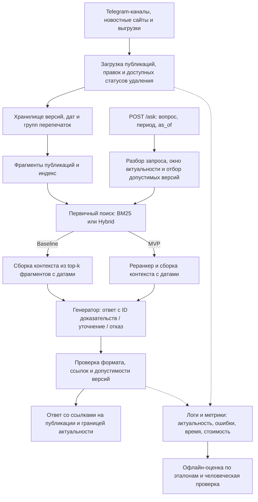

# ML System Design Doc: новостной RAG-ассистент

Самостоятельная [постановка исследования для статьи](https://github.com/bruhwalk/news-rag-research) использует его как экспериментальную платформу.

## 1. Цели и предпосылки

### 1.1. Зачем идем в разработку продукта?

**Пользователи:** читатели экономических и торговых новостей, которым
нужно проверить конкретный факт; аналитики, сотрудники компаний и журналисты,
которые готовят справки. Основная группа — люди, регулярно решающие такие
задачи.

**Проблема:** поиск по нескольким источникам, сопоставление публикаций и проверка
актуальности выполняются вручную. Перепечатки, исправления и неподтверждённые
заявления затрудняют подготовку ответа.

**Бизнес-цель:** сократить время получения проверенной фактической справки.
RAG должен находить доказательства в выбранных источниках и собирать понятный
ответ со ссылками. Экономия пользовательского времени остаётся гипотезой;
в этой итерации проверяется качество ответа по заданным критериям.

**Успех итерации:** ответы проходят офлайн-валидацию на отложенном наборе
вопросов: корректны, подтверждены источниками, актуальны и сохраняют важные
оговорки. Задержка и стоимость измеряются отдельно. Сравнение скорости работы
пользователей с обычным поиском в эту итерацию не входит.

### 1.2. Бизнес-требования и ограничения

**Сценарий:** пользователь спрашивает: «Какие предварительные результаты компания
опубликовала за сентябрь и что было известно на 1 октября?» Ассистент учитывает
временные ограничения и возвращает ответ, источники, даты и существенные оговорки.

| ID | Требование | Проверка |
| --- | --- | --- |
| BR-1 | Отвечать на фактические вопросы по экономическим и торговым новостям понятным языком | Набор целевых вопросов и ручная оценка по критериям §3.1 |
| BR-2 | Сохранять числа, единицы, сущности, периоды, условия и статус предварительных значений | Сверка обязательных фактов с эталонной разметкой |
| BR-3 | Подкреплять существенные утверждения ссылками на конкретные публикации | Проверка связок «утверждение — доказательство» |
| BR-4 | Не использовать сведения, недоступные на заданный момент; показывать границу актуальности | Исторические сценарии с поздними публикациями и правками |
| BR-5 | Учитывать доступные исправления, сохранять атрибуцию заявлений и показывать противоречия | Сценарии с обновлениями, слухами и перепечатками |
| BR-6 | Уточнять неоднозначный вопрос или сообщать о недостатке доказательств | Неоднозначные и неответимые вопросы; отдельный учёт ошибочных отказов |
| BR-7 | Для запросов о текущей ситуации выдавать новости в допустимом окне актуальности; не подменять свежие сведения устаревшими | Сценарии со свежими и старыми постами, перепечаткой старого события и отсутствием свежих данных |

**Достоверность источников:** наличие ссылки подтверждает, что источник
содержит утверждение, но не доказывает истинность самой новости. MVP проверяет
точность передачи публикаций, сохраняет атрибуцию и статус заявлений и показывает
существенные расхождения. Независимая проверка правдивости новостей — расширение
проекта, а не гарантия текущего RAG.

**Временная семантика:** период интересующих событий или публикаций и момент
доступного знания задаются отдельно. Если смысл периода неясен, система
уточняет его. По умолчанию момент — время запроса. Сентябрьская новость,
опубликованная в ноябре, недопустима для ответа «что было известно на 1 октября».
Нынешний текст отредактированного поста не подменяет его историческую версию.
«Последнее известное» означает последнее в доступных источниках с указанием
свежести корпуса.

**Актуальность:** для текущих запросов поиск ограничен периодом пользователя
или окном актуальности по умолчанию. Размер окна задаётся в конфигурации
и фиксируется после baseline с учётом типа новостей. Учитываются дата публикации,
дата события при наличии и более поздние исправления: свежая перепечатка
не делает старое событие новым. Если свежих доказательств нет или обновление
корпуса просрочено, ассистент сообщает об ограничении и не выдаёт старую новость
за текущую. Для исторических запросов действует заданный период.

| Ограничение | План первой итерации |
| --- | --- |
| Данные | Telegram-каналы и другие новостные источники. Состав и объём корпуса для первого baseline определяются по результатам EDA с учётом качества публикаций, покрытия тем и дат, а также пересечений между выгрузками. Для текущих запросов нужен обновляемый корпус |
| Обновление | Пакетная загрузка раз в сутки; ориентир отставания индекса — до 24 ч |
| Язык и нагрузка | Русский язык, один одновременный запрос на стенде MVP |
| Ресурсы | Один стенд; модели выбираются после первых измерений |
| Задержка и стоимость | Начальный ориентир p95 — до 20 с; предел стоимости запроса фиксируется после baseline |
| Бюджет | Платные вызовы моделей — после согласования бюджета |

### 1.3. Что входит в скоуп проекта/итерации, что не входит

**MVP закрывает BR-1…BR-7:** загрузка и обновление текстовых публикаций, версии,
дедупликация, временные фильтры, первичный поиск, реранкер, сборка контекста,
генератор, проверки ссылок и версий, простой API, логи, мониторинг и офлайн-оценка.

**За пределами MVP:** дополнительные эксперименты,
агенты, обучение моделей, многотуровой диалог, персональная лента,
обработка комментариев/аудио/видео/изображений, прогнозы, торговые операции,
высокая нагрузка и production-SLA.

**Качество кода и воспроизводимость:** Ruff, pre-commit и CI; документированные
команды запуска. Для оценки сохраняются версия кода, срез корпуса, настройки
поиска, модели, промпты и ответы. Проверки добавляются для критичных правил
временного отбора, версий и ссылок по мере реализации.

**Технический долг:** ручной отбор источников и части разметки, один стенд,
пакетное обновление и отсутствие отказоустойчивости.

### 1.4. Предпосылки решения

| Предпосылка | Обоснование и способ проверки |
| --- | --- |
| Допустим сбор и использование выбранных публикаций для RAG и оценки | Проверить условия платформы, источников и необходимые согласия до сбора |
| Публикации содержат достаточно текста, дат и ссылок | Проверить на небольшом корпусе |
| Значимая часть вопросов решается по нескольким публикациям | Вручную разобрать примеры до выбора моделей |
| Перепечатки можно выделять в группы | Проверить дубли на примерах; копии одного сообщения не считать независимыми доказательствами |
| Доступна независимая разметка | Основную разметку готовит разработчик, часть набора проверяет второй человек |

Источники: согласованные Telegram-каналы, новостные сайты и готовые выгрузки.
Адаптеры API, парсинга и импорта приводят записи к единой схеме новости;
неизвестные даты и версии не восстанавливаются догадками.

Единица данных — **версия публикации**, единица поиска — фрагмент с привязкой к ней,
единица оценки — вопрос и существенные утверждения ответа.
Точный состав экономических и торговых источников фиксируется перед сбором.

## 2. Методология

### 2.1. Постановка задачи

Задача — информационный поиск и генерация фактического ответа по доказательствам
из выбранного корпуса новостных публикаций.

**Вход API `POST /ask`:** вопрос, необязательный период и его тип, актуальная дата.
Даты нормализуются в UTC, часовой пояс вопроса учитывается явно.
**Выход:** ответ / уточнение / недостаток данных, доказательства и ссылки,
даты, граница актуальности и `request_id`. Идентификатор среза корпуса
сохраняется для воспроизведения запроса.

**Baseline:** BM25 или Hybrid (лексический и векторный поиск) с временными
фильтрами, контекст из top-k фрагментов и готовая LLM, без реранкера. Конкретный
вариант и его параметры выбираются на development-наборе и фиксируются до теста.
**MVP:** тот же выбранный поиск с готовым реранкером перед сборкой контекста.
Его вклад проверяют относительно baseline, сохраняя первичный поиск, генератор,
промпты и срез данных неизменными. Для Hybrid фиксируются также модель
эмбеддингов и способ объединения выдач.

### 2.2. Блок-схема решения

Общая схема показывает baseline и добавление реранкера в MVP.

URL формируются сервером из сохранённых источников. Проверки структуры и ссылок
не гарантируют правильность текста. Тексты источников трактуются как данные;
инструкции внутри них не должны управлять системой.

### 2.3. Этапы решения задачи

#### Этап 1. Подготовка данных

[Отчёт EDA](../eda/README.md) и [ноутбук с расчётами](../eda/eda.ipynb) описывают
два снимка корпуса и правила отбора.

| Данные | Что есть и что берём для baseline |
| --- | --- |
| Telegram | 89 832 текстовых поста из 12 каналов за 09.11.2025–08.11.2026 (UTC). После удаления четырёх постов из одного `@username` остаётся 89 828. Для первых вопросов доступны 15 453 поста за сентябрь и октябрь. [Манифест](reference/telegram_all12.json) |
| Trade | 103 190 строк очищенного XLSX из 331 веб-домена. После объединения строк с одним URI получаем 101 963 документа. После отбора по метке `ru` и исключения 224 служебных текстов остаётся 60 879 кандидатов для индекса. [Манифест](reference/trade_news_full.json) |

**Получение и хранение.** Telegram выгружен через API в JSONL. Trade получен
одной выгрузкой XLSX и преобразован в JSONL. Сейчас это разовые снимки.
Для MVP планируется пакетная загрузка согласованных источников раз в сутки
с журналом обновлений и сохранением наблюдаемых версий. Для каждой публикации
храним ID, текст, URL, источник, язык и `published_at` при наличии. Отдельно
храним хеш текста, время наблюдения версии, доступные метаданные правки и
статус удаления. Для фрагмента сохраняем ID версии и координаты в оригинале.
[Схема записи новости](../schemas/news_document.schema.json)

**Качество и отбор.** В Telegram типовые подписи каналов могут загрязнять поиск.
Удаляем из поисковой копии проверенные подписи конкретного канала и сохраняем
исходник для цитирования. В Trade один URI может иметь одинаковый текст и разные
метаданные. Индексируем текст один раз и сохраняем привязку меток к исходным
строкам. `dates` используем для описания покрытия, пока его смысл неизвестен.
Прямые ссылки и общие фрагменты дали 226 пар кандидатов на перепечатки между
выгрузками. Объединяем подтверждённые копии после проверки события, периода и
происхождения. Ссылки сохраняем. Противоречащие утверждения храним с атрибуцией.

**Достаточность данных.** Объёма хватает для первого поиска и отбора 100 вопросов.
Готового эталона ответов и доказательств пока нет. Для каждого вопроса размечаем
обязательные факты, ссылки на версии и допустимый ответ, уточнение или отказ.
Снимки покрывают поиск и ответы по сохранённым публикациям. Для вопросов о
прошлом нужны архивные редакции с подтверждённым временем доступности. На
пилотной разметке считаем число вопросов, для которых таких доказательств не
хватает, и добираем версии для каждого обязательного доказательства. Для
вопросов о текущих событиях нужны регулярные обновления источников.

**Конфиденциальность.** В текстах и метаданных могут встречаться личные контакты,
идентификаторы и частный контекст. Маскируем контакты и личные идентификаторы,
которые не нужны для ответа, и исключаем чувствительные фрагменты без
доказательной ценности. Сохраняем атрибуцию публичных заявлений. В репозиторий
выкладываем код, манифесты и агрегаты EDA. Сырые снимки, ключи и сессии храним
отдельно. В генератор передаём только допустимые для передачи фрагменты.

**Результат этапа.** Версионированный срез JSONL, правила отбора и очистки,
манифесты с хешами и разметка вопросов с привязкой к версиям источников.

#### Этап 2. Подготовка моделей

**Baseline и MVP.** Baseline использует BM25 или Hybrid и готовую LLM.
Отбираем допустимые версии до top-k, собираем контекст и передаём его LLM.
Для MVP добавляем готовый реранкер над кандидатами того же поиска. Модели
используем без обучения, поэтому функцию потерь для baseline и MVP не
оптимизируем. Конфигурации выбираем по метрикам на development.

**Разбиение для индексации.** Стартовый порог — **400 слов**. Публикации до
400 слов включительно индексируем целиком, более длинные делим по смысловым
границам, сохраняя число, единицу, период и оговорку в одном фрагменте. Для
подсчёта слов используем пробельные разделители, как в EDA. По данным EDA,
порог превышают 1,1% постов Telegram и 9,0% русскоязычных статей Trade.
Допустимую длину фрагмента в токенах проверяем токенизатором выбранной модели.
[Распределение длины текстов](../eda/README.md#как-устроен-текст)

| Что измеряем | Зачем |
| --- | --- |
| Recall@k по эталонным доказательствам | Доля размеченных доказательств, попавших в top-k на разрешимых вопросах. Показывает, хватило ли найденных фрагментов для ответа |
| Доля приемлемых ответов по §3.1 | Оценивает всю цепочку, включая факты, оговорки, источники и корректность отказа. Отдельно считаем результат на разрешимых и неразрешимых вопросах |
| Доля подтверждённых существенных утверждений и случаи использования будущих сведений | Проверяют ссылки и соблюдение границы времени. Целевые пороги заданы в §3.2 |
| p50/p95 задержки и стоимость запроса | Показывают цену улучшения качества. p95 сравниваем с ориентиром 20 с из §1.2 на одном стенде |

**Валидация.** Из 100 вопросов 50 идут в development и 50 в закрытый test.
Вопросы покрывают числа и оговорки, сопоставление источников, временные случаи,
ложные предпосылки, недостаток данных и неоднозначность. Варианты одного
события, версии, перепечатки и перефразировки остаются в одном наборе.
По возможности более поздние события отдаём в test после проверки пересечений.
На development сравниваем целые публикации и разбиение с порогом 400 слов.
Фиксируем поиск, генератор, срез и бюджет контекста. Порог уточняем по Recall@k,
качеству ответов и задержке. BM25 и Hybrid сравниваем при одинаковых временных
правилах и бюджете контекста. На development выбираем top-k и модель. Для Hybrid
фиксируем модель эмбеддингов и способ объединения выдач. Закрытый test
запускаем после фиксации конфигураций и рубрики. Baseline и MVP
сравниваем на одинаковых вопросах, срезах и временных правилах. При проверке
реранкера фиксируем первичный поиск, генератор и промпт. Показываем знаменатели
по типам вопросов и отделяем контрольные сценарии от проверки на реальном корпусе.

**Развитие и разбор ошибок.** Сохраняем кандидатов поиска, итоговый контекст и
ответ. Это позволяет отличить пропуск документа, ошибку ранжирования и искажение
факта генератором. В пробе FTS5 запросы `85%` и `85` дали одинаковые результаты.
Если такие ошибки повторятся на development, проверим выделение чисел и единиц.
В сравнении BM25 и Hybrid отдельно проверим перефразировки. Метки Trade проверим как дополнительный
сигнал, поскольку жёсткий фильтр по метке теряет часть кандидатов. Счётчики
просмотров зависят от канала, поэтому в первом baseline их не используем.
Изменения проверяем по одному и учитываем стоимость и задержку.

**Результат этапа.** Воспроизводимые конфигурации baseline и MVP, таблица метрик,
разбор ошибок и решение о включении реранкера.

#### Этап 3. Проверка времени, доказательств и ответа RAG

- **Временной отбор.** Различаем время публикации, дату события и момент
  доступности конкретной версии текста. Для запроса с `as_of` оставляем
  только версии, доступность которых подтверждена к этому моменту. Если
  известно только время наблюдения, используем его как консервативную границу.
  Для текущих запросов проверяем окно актуальности и время последнего
  обновления корпуса. Свежая перепечатка сама по себе не делает событие новым.
- **Сборка ответа.** Передаём в генератор фрагменты с ID версий, датами и
  источниками. Сервер проверяет, что процитированные ID были в контексте и
  допустимы по времени, затем подставляет сохранённые URL. При конфликте
  приводим атрибуцию. При нехватке доказательств сообщаем об ограничении,
  при существенной неоднозначности уточняем вопрос.
- **Проверки.** Для поздней публикации, недоступной редакции, старого события,
  ложной предпосылки и выдуманной ссылки задаём ожидаемое поведение. При
  отсутствии архивной версии используем контрольные примеры с известным
  временем доступности, а на реальном снимке проверяем обоснованный отказ.
  Проверку ID и временных ограничений автоматизируем, подтверждение смысла
  и сохранность чисел оцениваем по рубрике §3.1.

**Результат этапа.** Ответ с проверенными ссылками и границей актуальности либо
обоснованное уточнение или отказ. На стенде MVP подключаем API, журнал запросов
и обновлений, измеряем задержку, стоимость и отставание индекса по §3.3.

**Возможные эксперименты по улучшению качества:**

- **Веб-проверка:** сравнить базовый RAG и RAG с ограниченным поиском внешних
  доказательств; учесть временную допустимость источников, ошибки, задержку и стоимость.
- **LLM-судья:** проверить пользу офлайн-оценки ответов на независимой человеческой
  разметке и примерах с подмешанными ошибками; измерить пропуски и ложные тревоги.
- **Улучшение реранкера:** сравнить готовый реранкер с дообученным на предпочтениях
  между документами, сохранив первичный поиск и генератор неизменными.
- **DPO генератора:** проверить дообучение на парах предпочтительных и непредпочтительных
  ответов для одинаковых вопросов и контекста, сохранив поиск и реранкер неизменными.

Если обучающие предпочтения формирует LLM-судья, их надёжность предварительно
проверяется по человеческой разметке. Каждый компонент улучшается отдельно;
результат сравнивается с исходной конфигурацией на независимом отложенном наборе
по качеству ответов, задержке и стоимости.

## 3. Подготовка пилота

### 3.1. Способ оценки пилота

В этой итерации используется **офлайн-валидация ответов**, без набора
пользователей и сравнения времени подготовки справок. На закрытом наборе
запускаются baseline и MVP. Для вопроса заранее фиксируются обязательные факты,
доказательства, временные ограничения и допустимый ответ, уточнение или отказ.
Проверяется смысл ответа, а не буквальное совпадение с эталонным текстом.

| Критерий | Условие прохождения |
| --- | --- |
| Фактическая корректность | Верны числа, единицы, сущности, даты и периоды; нет выдуманных фактов |
| Подтверждённость | Существенные утверждения подкреплены конкретными постами; ссылки и версии допустимы, заявления точно атрибутированы |
| Актуальность и время | Соблюдены период и момент доступного знания, учтены исправления; старые сведения не выданы за текущие |
| Полнота | Сохранены обязательные факты, условия, оговорки и существенные противоречия |
| Ответ или отказ | При достаточных доказательствах дан ответ; при нехватке данных или неоднозначности — обоснованный отказ или уточнение |
| Понятность | Ответ относится к вопросу, понятен читателю и не содержит лишних рассуждений |

Каждый критерий получает «выполнен / не выполнен / неприменим».
Ответ считается приемлемым, если выполнены все применимые критерии. Ошибки в фактах, источниках и времени не компенсируются хорошим стилем. Отдельно учитываются ответы на разрешимые вопросы, корректные отказы и необоснованные отказы, чтобы отказ всем не улучшал итоговую оценку.

Идентификаторы ссылок и допустимость версий проверяются программно; смысл,
полнота и атрибуция — вручную по источникам. При возможности второй проверяющий
размечает часть ответов без названия конфигурации; разногласия разбираются.
Отсутствие независимой проверки явно указывается как ограничение.

### 3.2. Что считаем успешным пилотом

Предварительные цели качества на закрытом тесте:

- Не менее **80%** ответов проходят все применимые критерии §3.1;
  отдельно проверяются разрешимые вопросы и случаи отказа или уточнения.
- Не менее **95%** существенных утверждений подтверждены допустимыми источниками.
- **Ни одного выявленного использования сведений из будущего** на тесте.

Успех проверки — достижение заранее зафиксированной доли приемлемых
ответов и порогов задержки/стоимости. Пороги и рубрика могут быть уточнены после baseline
на development-наборе и фиксируются до итогового теста. По каждому критерию и типу вопросов
показываются число примеров, доля прохождения и критические ошибки.
Реранкер включается в итоговую конфигурацию при измеримом улучшении относительно
baseline и приемлемых затратах. При недостатке данных выигрыш не объявляется
доказанным. Экономия пользовательского времени этой проверкой не подтверждается.

### 3.3. Подготовка пилота

Подготавливаются закрытый набор, рубрика, фиксированный срез корпуса и конфигурации,
а также отчёт с ответами, доказательствами, оценками и разбором ошибок. Настройка
по результатам закрытого теста не проводится; изменения проверяются на новом
отложенном наборе. Отдельно выполняются замеры задержки и стоимости на стенде.

Один сервис с `POST /ask` и `GET /health`, задача обновления корпуса, хранилище
версий и индекс. Логируются кандидаты, контекст, ответы, версии, отказы, время,
стоимость и ошибки; отслеживается свежесть корпуса. Артефакты сохраняются для
воспроизведения и отката. Выбор моделей и инфраструктуры — после замеров baseline.

До реализации нужно выбрать каналы, подтвердить условия доступа, ресурсы
и бюджет. Основные риски — отсутствие разрешённого корпуса, пробелы истории,
перепечатки, ошибки генерации и рост затрат. Меры: проверка доступа до сбора,
временной отбор, группировка дублей, ручная валидация и ограничения контекста.
Production-внедрение в эту итерацию не входит.
