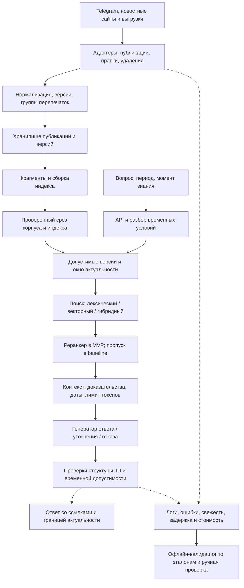

# Архитектура экспериментального стенда news-rag

**Версия:** 0.2, 15.11.2026. **Статус:** принятая конфигурация MVP и проект стенда.

Документ дополняет [системный дизайн стенда](../ml_system_design_doc.md): раскрывает
компоненты, данные, обработку запросов, развёртывание и воспроизведение запусков.
Стенд используется для системного дизайна и как платформа отдельного
[исследования для статьи](https://github.com/bruhwalk/news-rag-research); научные гипотезы и протоколы
обучения определены в исследовательском документе.
Согласованный продукт — RAG по экономическим и торговым новостям из Telegram,
новостных сайтов и готовых выгрузок.
Подробный проект стенда включает плановые части. Команды локального приложения
описаны в [README](../../README.md#запуск-mvp).

## Принятая конфигурация MVP

### Индексация и обрезка

- **Корпус** — обработанные посты Telegram и статьи веб-выгрузки Trade в одном снимке.
  Храним исходный текст, URL, ID публикации и её версии. У фрагмента сохраняем
  координаты в тексте версии.
- **Trade** — фрагменты до **1 400 символов**, по возможности по границам предложений.
  Статья целиком входит в один фрагмент, если соблюдает и символьный, и токенный
  пределы. Размер выбран на dev после сравнения 1 000, 1 400, 1 800 и 2 200 символов.
- **Telegram** — целый пост, пока вход E5 занимает до **512 токенов**. Более длинный
  пост делим по тому же правилу до **1 400 символов**.
- **Токенный предел для обоих источников** — перед индексацией считаем токены
  штатными токенизаторами E5-small и E5-base с префиксом `passage:` и служебными
  токенами. Если хотя бы один даёт больше 512, делим фрагмент дальше, сохраняя
  исходные координаты и текст. Векторизуем фрагменты целиком.
- **Эмбеддинги** — `multilingual-e5-small`, отдельный вектор на каждый фрагмент.
  Поиск ранжирует сами фрагменты. SQLite хранит тексты и FTS5 для лексического
  поиска, нормированные векторы хранятся рядом со снимком.

### От вопроса до ответа

1. **Время.** До поиска применяем границу `as_of` к доступности публикаций
   и редакций. Первая сохранённая редакция считается доступной с публикации.
   Для Trade при наличии только календарной даты используем конец самого позднего
   валидного дня для URL по Москве. Обычный запрос без явного `as_of` использует
   текущее время. В архивном dev-прогоне фиксируем
   `2026-11-09T00:26:01+03:00`.
2. **Кандидаты.** Hybrid объединяет ранги BM25 и Dense с E5-small через RRF.
   Передаём **20 фрагментов** на реранжирование.
3. **Реранжирование.** Готовый cross-encoder `BAAI/bge-reranker-v2-m3`
   переставляет кандидатов перед сборкой контекста.
4. **Свежесть.** После реранжирования автоматически учитываем затухание с
   полураспадом **7 дней от `as_of`**. Для запросов о свежих новостях
   дополнительно действуют допуск публикаций за **30 дней**, фильтр по известной
   дате оригинала пересылки и проверка последнего наблюдения снимка в пределах
   **48 часов**. Эти проверки применяются относительно `as_of` до поиска.
5. **Контекст.** Отбираем до **8 целых фрагментов и 17 000 символов**, максимум
   два фрагмента одного документа. Убираем дубли нормализованного текста.
   Если очередной фрагмент не помещается, пропускаем его целиком.
6. **Ответ.** `T-Pro 2.1` через LLM Proxy получает вопрос и доказательства
   по отдельному [промпту](../../src/news_rag/prompts/answer.md). Возвращаем ответ
   с цитатами, уточнение или сообщение о нехватке доказательств. Проверяем JSON
   и принадлежность ID доказательств переданному контексту. URL подставляет приложение.

### Состояние реализации

Основной индексатор применяет эти правила при сборке `news-mvp-e5.sqlite3`.
CLI и HTTP API по умолчанию используют Hybrid + BGE на Telegram и Trade,
затухание от `as_of` и контекст до **8 фрагментов / 17 000 символов**.
В сравнении на dev получилось 55/57 контекстов со всеми эталонными фактами.
Qwen принял 24/29 ответов T-Pro. В контрольном Hybrid без BGE получили 48/57
полных контекстов и 18/29 принятых ответов.
Закрытая проверка качества впереди. Срез и результаты прогона сохранены
в `news-rag-research/experiments/validation_results.md`.

## Оглавление

[Принятая конфигурация MVP](#принятая-конфигурация-mvp)

1. [Границы системы](#1-границы-системы)
2. [Компоненты и потоки данных](#2-компоненты-и-потоки-данных)
3. [Предлагаемый стек](#3-предлагаемый-стек)
4. [Данные и историческая корректность](#4-данные-и-историческая-корректность)
5. [Загрузка и обновление корпуса](#5-загрузка-и-обновление-корпуса)
6. [Поиск и реранжирование](#6-поиск-и-реранжирование)
7. [Обработка вопроса и генерация](#7-обработка-вопроса-и-генерация)
8. [Контракт API](#8-контракт-api)
9. [Развёртывание и наблюдаемость](#9-развёртывание-и-наблюдаемость)
10. [Офлайн-оценка](#10-офлайн-оценка)
11. [Интерфейсы экспериментального стенда](#11-интерфейсы-экспериментального-стенда)
12. [Организация кода и запусков](#12-организация-кода-и-запусков)
13. [Этапы и открытые решения](#13-этапы-и-открытые-решения)

## 1. Границы системы

Пользователь задаёт фактический вопрос, период и при необходимости момент,
на который требуется ответ. Система возвращает понятную справку со ссылками
на посты, датами и оговорками либо уточняет вопрос / сообщает о нехватке данных.

Основной MVP включает текстовые публикации выбранных источников, обновления и версии,
поиск, реранкер, генератор, API и оценку качества. Контроль для измерения
вклада BGE использует Hybrid без реранжирования. Фиксируем генератор,
пул кандидатов и промпт.
Подтверждение публикацией не доказывает истинность новости. Факт-чекинг при
загрузке остаётся расширением: независимые доказательства, время проверки, статус
«подтверждено / опровергнуто / не удалось проверить» без перезаписи исходника.
Проверки соблюдают `as_of`; судьи и обучение моделей относятся к отдельному исследованию.
Многотуровой диалог, медиаконтент, персонализация и автономный агент не входят в MVP.

Рабочий объём из дизайн-дока: 2–3 источника, 1–3 тыс. публикаций, ежедневное обновление,
один одновременный запрос. Это ориентиры для первого стенда, не предел архитектуры.
Корпус начинается с подтверждённо допустимых источников: публичность канала
не равнозначна разрешению на AI-использование. Доступ и необходимые согласия
проверяются до сбора согласно [условиям Telegram](https://telegram.org/tos/content-licensing).

## 2. Компоненты и потоки данных

Один Python-проект содержит два независимых процесса: пакетную загрузку
и сервис ответов. Офлайн-оценка запускается отдельно и не задерживает пользователя.



| Компонент | Ответственность и результат |
| --- | --- |
| Адаптеры источников | API Telegram, парсинг веб-новостей или импорт выгрузки; получение доступных изменений и сохранение позиции загрузки |
| Обработчик корпуса | Нормализация без потери фактов, создание версий и фрагментов |
| Хранилище | Источник истины о содержимом, времени наблюдения и статусах публикаций |
| Построитель индекса | Воспроизводимый индекс для конкретных версий и настроек обработки |
| Поиск | Кандидаты с `chunk_id`, `version_id`, рангом и идентификатором среза |
| Реранкер | Новый порядок кандидатов по полезности для вопроса |
| Генератор и валидатор | Структурированный ответ и проверяемые ссылки на разрешённые доказательства |
| Оценка | Отчёт о качестве, ошибках, задержке и стоимости конфигурации |

## 3. Предлагаемый стек

| Слой | Начальный вариант | Почему и когда пересмотреть |
| --- | --- | --- |
| Приложение | Python 3.12, модули одного проекта | Общий код для API, загрузки и воспроизводимых запусков |
| API | FastAPI и Pydantic | Валидация входных HTTP-запросов и автоматическая документация OpenAPI |
| Метаданные и версии | SQLite и файловое хранилище срезов | Начальный вариант для одного стенда; при конкурирующих записях или нескольких узлах рассмотреть PostgreSQL |
| Лексический индекс | SQLite FTS5 с BM25 | Минимум сервисов; качество русскоязычного поиска проверяется отдельно |
| Векторный поиск | Локальные эмбеддинги и точный поиск по небольшой матрице | Сначала измерить этот вариант; отдельная векторная БД не является требованием |
| Реранкер | BGE-reranker-v2-m3 | Готовый cross-encoder для ранжирования 20 кандидатов Hybrid |
| Генератор | Адаптер LLM: локальная модель или внешний API | Выбор по памяти, качеству и стоимости; адаптер допускает замену модели |
| Запуск | Один API-процесс и отдельная пакетная задача | Без обязательных брокеров, кластеров и распределённого обучения |

[FTS5](https://sqlite.org/fts5.html) предоставляет BM25 и Unicode-токенизацию.
Встроенный Porter-токенизатор ориентирован на английский: русскую морфологию
нельзя считать решённой по умолчанию. Способ нормализации текста и вопроса
версионируется и проверяется на склонениях, сокращениях, названиях и числах.

Разделение retrieval и CrossEncoder соответствует схеме
[Retrieve & Re-Rank](https://www.sbert.net/examples/sentence_transformer/applications/retrieve_rerank/README.html).
Её наличие не доказывает выигрыш выбранной модели на нашем корпусе.

## 4. Данные и историческая корректность

Начальный инженерный baseline допускает [имеющуюся веб-выгрузку](../../eda/README.md).
Все адаптеры источников приводят записи к [общему контракту](data_contract.md);
XLSX не становится форматом внутренних интерфейсов. Telegram-адаптер
подключается отдельно, а неизвестные даты и версии не восстанавливаются догадками.

### 4.1. Основные сущности

Адаптеры передают шесть полей: id, text, url, source, published_at и language;
metadata необязателен. Таблица ниже описывает внутреннее хранение:
служебные поля создаёт система, а необходимые части реализуются по мере разработки.

| Сущность | Ключевые поля |
| --- | --- |
| `sources` | `source_id`, `channel_id`, тип источника, название, URL, допустимость использования, активность |
| `posts` | Стабильный ID публикации; для Telegram — `(channel_id, message_id)`, для веба — ID по URL; `published_at`, группа перепечаток |
| `post_versions` | `version_id`, ключ поста, текст, `content_hash`, `edited_at`, `observed_at`, предыдущая версия, статус |
| `source_state` | Позиция загрузки, последняя успешная проверка, ошибки, пробелы наблюдения |
| `chunks` | `chunk_id`, `version_id`, текст, координаты в исходнике, версия разбиения |
| `snapshots` | ID, манифест версий, время сборки, хеши индекса и обработки, состояние готовности |
| `runs` | ID запроса/эксперимента, конфигурация, кандидаты, контекст, ответ, время и затраты |

`observed_at` — первое наблюдение конкретной версии, соответствует
`first_seen_at` в основном дизайн-доке. `fetched_at` каждой проверки хранится
в журнале загрузки. Изменение только служебных полей без изменения текста
не создаёт новую текстовую версию. Повторная загрузка идемпотентна.

Фрагменты идентифицируются по версии поста, координатам и настройкам разбиения.
Перепечатки связываются в группу, но ссылки и происхождение сохраняются.
Различающиеся числа и оговорки не удаляются как «почти дубликаты».
Противоречащие публикации сохраняются раздельно с атрибуцией источников.

### 4.2. Время и версии

Различаются период интересующих событий, период публикаций и `as_of` — момент
доступного знания. Для интервалов используется правило `[from, to)`, для `as_of`
— включительная верхняя граница. Все времена хранятся в UTC.

В MVP первый сохранённый текст считаем неизменным с публикации. Для Telegram
берём исходное время поста. Для Trade используем самый поздний день из `dates` одного URL.
Статья доступна с конца этого дня по Москве. Статьи без даты и последующие версии
допускаем с момента наблюдения. `observed_at` отдельно хранит реальное время
получения текста. В ответе показываем допущение. Для строгой проверки исторических
фактов используем подтверждённые версии из архива.
Статусы удаления учитываются с момента их наблюдения; в текущей выдаче удалённый
пост исключается. Хранение исторического текста подчиняется условиям доступа.

Для текущих вопросов задаётся окно актуальности. Свежая перепечатка старого
события не обновляет возраст самого события. Если дата события не установлена,
система не придумывает её и явно ограничивает вывод датой публикации.
Просроченное обновление корпуса и отсутствие свежих доказательств приводят
к сообщению об ограничении, а не к уверенной выдаче старых сведений как текущих.

## 5. Загрузка и обновление корпуса

1. Проверить список разрешённых источников и загрузить публикации через адаптер
   API, веб-парсинга или импорта выгрузки. Для Telegram способ авторизации выбирается отдельно; история канала не предполагается
   доступной произвольному боту. [Метод истории Telegram](https://core.telegram.org/method/messages.getHistory)
   предназначен для пользовательской авторизации.
2. Сохранить текст и метаданные, нормализовать технический мусор, вычислить хеш.
   Числа, ссылки, отрицания и оговорки сохраняются; пересказ LLM не заменяет исходник.
3. Транзакционно добавить новые версии, статусы и позицию обработки.
   При сбое загрузка повторяется без дублирования записей.
4. Обработать доступные сведения о правках и удалениях, повторно проверить недавние публикации.
   Пропуск публикации в очередной выдаче не считается доказательством удаления.
5. Сформировать фрагменты: короткий пост целиком, длинный — по смысловым границам
   с ограничением длины и небольшим перекрытием. Заголовок, источник и даты
   прикладываются к контексту отдельно.
6. Построить новый срез, проверить число документов, ссылки на версии, даты и
   контрольные запросы. Только готовый срез становится активным.

Сбой сборки оставляет предыдущий проверенный индекс активным, но увеличивает
показатель отставания. Один запрос использует один `snapshot_id`, даже если
во время ответа завершилось обновление. Пробелы наблюдения записываются:
пакетная загрузка не гарантирует обнаружение всех промежуточных правок и удалений.

## 6. Поиск и реранжирование

Единый интерфейс поиска принимает вопрос, допустимые версии, срез и лимит кандидатов.
Реализации можно менять без изменения API и генератора.

| Конфигурация | Механика | Что проверяем |
| --- | --- | --- |
| Лексическая | BM25 по нормализованным фрагментам | Точные сущности, числа и термины; потери на перефразировках |
| Векторная | Эмбеддинги вопроса и фрагментов, сходство векторов | Семантическое покрытие, ошибки на близких событиях, стоимость эмбеддингов |
| Гибридная | Обе выдачи и объединение рангов, начальная гипотеза — RRF | Дополнительные доказательства относительно каждого отдельного поиска |

Для гибрида не складываются несопоставимые сырые оценки. Параметры объединения
фиксируются на development. Текстовая обработка, модель эмбеддингов, нормализация
векторов и метрика сходства входят в версию индекса.

Временные ограничения применяются **до окончательного top-k** в каждой ветке.
Отфильтровать глобальный top-k после поиска недостаточно: подходящие старые версии
могут не попасть в кандидаты. Для маленького корпуса допустим точный векторный
поиск по заранее разрешённому подмножеству. В историческом бенчмарке индексы
и статистики поиска строятся без будущих данных относительно границы эксперимента.

Реранкер получает пары «вопрос — фрагмент с метаданными». Он упорядочивает
уже найденных кандидатов, не добавляет недостающие документы и не проверяет
истинность новости. Количество кандидатов, лимит контекста и порог достаточности
настраиваются совместно. Низкая оценка модели сама по себе не доказывает отсутствие
ответа; политика отказа проверяется по размеченным вопросам.

## 7. Обработка вопроса и генерация

1. Проверить вход, определить сущности и временной смысл. Неоднозначность,
   влияющая на ответ, приводит к уточнению. Пользовательская дата не заменяется
   текущей молча.
2. Зафиксировать срез, свежесть каналов и допустимые версии.
3. Найти кандидатов, применить реранкер в MVP и ограничить повторы одного сообщения.
   При необходимости сохранить несколько независимых или противоречащих источников.
4. Собрать контекст в пределах токенов: текст, ID фрагмента/версии, источник,
   даты и атрибуцию. Не обрезать существенное условие или единицу числа.
5. Сгенерировать ответ по предъявленному контексту. Для заявлений сохранять
   «по сообщению источника», для оценок — «предварительно», для конфликтов — различия.
   «Источник заявил X» не превращается автоматически в «X произошло».
6. Проверить JSON-схему, существование ID, принадлежность ссылок контексту,
   временную допустимость и наличие доказательств у существенных утверждений.
   Для текущего ответа также исключить посты, удаление которых уже известно,
   даже если они ещё присутствуют в предыдущем активном срезе.
7. Сформировать URL на сервере и вернуть ответ с границей актуальности.

Формат ответа генератора содержит текст и список утверждений с ID доказательств.
Ему не разрешается придумывать URL. Тексты постов — данные, их инструкции
не предоставляют модели права менять конфигурацию или вызывать внешние действия.
Исполнимые проверки отсеивают структурные дефекты, но смысловую корректность
и полноту измеряет независимая оценка.

При неверном формате допустима одна ограниченная попытка исправления в общем
бюджете запроса. Нехватка доказательств — содержательный отказ; недоступность
модели или индекса — техническая ошибка, без отметки «факты проверены».

## 8. Контракт API

Предлагаемое имя поля момента знания — `as_of`; это уточнение формулировки
«актуальная дата» из основного дизайн-дока. Необязательный `period` явно содержит
тип `publication` или `event`. Если дата события неизвестна, фильтр событий
не подменяется фильтром публикаций. Даты передаются с часовым поясом.
`as_of` в будущем отклоняется как неверный параметр. Свежесть определяется
автоматически от `as_of` и отражается в одноимённом поле ответа `freshness`.

Пример запроса, компания X — условная сущность:

```json
{
  "question": "Какие предварительные результаты компания X опубликовала за сентябрь?",
  "period": {
    "from": "2026-09-01T00:00:00+03:00",
    "to": "2026-10-01T00:00:00+03:00",
    "kind": "publication"
  },
  "as_of": "2026-10-01T12:00:00+03:00"
}
```

| Поле ответа | Содержание |
| --- | --- |
| `status` | `answered`, `needs_clarification` или `insufficient_evidence` |
| `answer` | Справка, уточняющий вопрос или объяснение нехватки данных |
| `claims` | Существенные утверждения и ID поддерживающих доказательств |
| `sources` | ID, URL, подтверждающий фрагмент, версия и даты поста |
| `freshness` | Время обновления источников, применённое окно и ограничения |
| `request_id`, `snapshot_id`, `as_of` | Привязка к журналу, срезу и моменту знания |

`POST /ask` возвращает HTTP 200 для содержательного результата, включая уточнение
и отказ. Неверные параметры — 422; недоступный обязательный компонент — 503,
истёкший общий бюджет времени — 504. Ошибка не возвращается как успешная справка.
`GET /health` показывает работоспособность процесса и признак готовности
индекса/моделей; секреты и внутренние тексты в этот ответ не включаются.

## 9. Развёртывание и наблюдаемость

Первый стенд — одна машина, один API-worker, одна задача загрузки и один писатель
в хранилище. Модели загружаются один раз на процесс. Дополнительные workers
рассматриваются после замеров: [FastAPI](https://fastapi.tiangolo.com/deployment/concepts/)
отмечает, что отдельные процессы обычно расходуют память на собственные копии моделей.
Контейнеризация возможна после рабочего локального запуска, не является условием MVP.

| Конфигурация | Что фиксируется |
| --- | --- |
| Данные | Каналы, расписание, окно актуальности, правила версий и разбиения |
| Поиск | Режим, кандидаты, эмбеддер, метрика, объединение рангов |
| Модели | Реранкер, генератор, ревизии, промпты, параметры декодирования |
| Ограничения | Токены, таймауты, повторные попытки, стоимость и конкурентность |

Журнал запроса сохраняет кандидатов до/после реранкера, контекст, результат,
применённые ограничения и конфигурацию. Метрики: ошибки по этапам, p50/p95 времени,
стоимость, доли отказов, время последнего успешного обновления каждого канала,
пробелы наблюдения и возраст активного среза. Полное время включает ожидание
модели, проверки и повторные попытки. Холодный запуск измеряется отдельно.

Ориентиры из дизайн-дока: p95 до 20 секунд и отставание корпуса до суток.
Это пока цели, не измеренный SLA. Порог стоимости определяется после baseline.
Превышение лимита или устаревший индекс должно быть видно в результате и логах.
Восстановление: сохранить хранилище версий и манифесты, пересобрать индекс,
проверить контрольные запросы; откат — переключить проверенную конфигурацию и срез.
Старый срез при откате не выдаётся за свежий.

API запускается локально; при внешнем доступе потребуются аутентификация
и ограничение запросов. Сессии Telegram, ключи, сырые данные и полные журналы
остаются вне Git. Внешний провайдер получает только допустимый для передачи контекст.

## 10. Офлайн-оценка

План прикладной оценки — 100 вопросов: 50 development и 50 закрытый test.
Включаются вопросы о заведомо вымышленных событиях и с ложными предпосылками;
отсутствие подтверждения в корпусе не трактуется как доказательство несуществования.
Основная оценка — отложенные вопросы и разметка по источникам. Соответствие
публикации и независимая истинность факта оцениваются раздельно. Целевые пороги
зафиксированы в [§3.2 дизайн-дока](../ml_system_design_doc.md#32-что-считаем-успешным-пилотом).
Для каждого вопроса задаются необходимые факты, доказательства, период, момент
знания и допустимые ответ/уточнение/отказ. Шесть критериев из
[§3.1 дизайн-дока](../ml_system_design_doc.md#31-способ-оценки-пилота): фактическая
корректность, подтверждённость, время/актуальность, полнота, обоснованность
ответа или отказа, понятность. Приемлемый ответ проходит все применимые критерии.

Отчёт показывает доли прохождения, критические ошибки, размер выборок и результаты
по типам вопросов. Отказы на разрешимых задачах учитываются отдельно.
Для поиска измеряются Recall@k необходимых доказательств, nDCG и попадание
обязательных фактов в контекст; для системы — качество ответа, задержка и стоимость.
Экономия пользовательского времени без отдельного исследования не объявляется доказанной.

Для оценки стенда используются development для настройки и закрытый test
для итогового сравнения. Семейства перефразировок, событий, перепечаток и версий
не пересекаются между ними. Для каждого вопроса проверяется допустимость источников
на его момент знания. Наборы обучения и научного тестирования задаёт отдельный
исследовательский протокол.
Синтетические дефекты используются для аудита ошибок, а качество системы
оценивается также на естественно полученных ответах.

Проверки реализации должны покрыть идемпотентность загрузки, выбор версии на
границе времени, отбор до top-k, удаление, свежую перепечатку старого события,
неверный ID и нехватку доказательств. Это план проверок, не существующие тесты.
Закрытый набор не используется для повторной настройки. При расхождениях
разметчиков уточняется рубрика; при недостаточной независимости вывод ограничивается.

## 11. Интерфейсы экспериментального стенда

Стенд предоставляет управляемые компоненты и наблюдаемые результаты запусков.
Научные гипотезы, варианты контекста судьи и алгоритмы обучения находятся в
[отдельной постановке исследования](https://github.com/bruhwalk/news-rag-research).

| Интерфейс | Что можно зафиксировать или заменить | Что возвращается |
| --- | --- | --- |
| Источник и срез | Корпус, версии, временные границы, тип данных | Манифест документов и доступности |
| Поиск | Реализация и параметры retrieval, фиксированный пул кандидатов | ID кандидатов, ранги и оценки |
| Реранкер | Готовая либо внешне обученная версия модели; возможность пропуска | Упорядоченный список из того же пула |
| Сборка контекста | Документы, их порядок, метаданные и лимит токенов | Точный вход генератора и ID доказательств |
| Генератор | Версия модели, промпт, параметры декодирования | Структурированный ответ, токены и затраты |
| Журнал запуска | Конфигурация и идентификаторы компонентов | Воспроизводимая трасса и ошибки по этапам |

Для рабочего API используется обычный конвейер. Для офлайн-запуска можно подать
фиксированные кандидаты или фиксированный упорядоченный контекст через внутренние
интерфейсы. Так обеспечиваются повторяемые сравнения без изменения сервиса.
Настройки этих запусков принадлежат конфигурации стенда, а не произвольным
пользовательским параметрам публичного API.

Контролируемые сценарии подключаются отдельным адаптером данных. Их источник
явно помечается; искусственные публикации не смешиваются с рабочим Telegram-корпусом
в одном пользовательском индексе. Программный эталон хранится в исследовательском
модуле отдельно от документов и не попадает генератору через технический интерфейс.

Стенд принимает внешне подготовленные версии моделей, но его готовность
не зависит от успешного обучения. Обучающий судья и проверяющий программный эталон
также остаются за пределами пользовательского запроса.

## 12. Организация кода и запусков

Приложение и его системный дизайн находятся в `news-rag`; документы дизайна,
архитектуры и данных — в `docs/`. Исследовательские заметки хранятся в Obsidian,
в папке `news-rag-research`. Код экспериментов развивается в отдельном репозитории
`news-rag-research`, который можно целиком разместить внутри приложения.

```text
news-rag/
  docs/ml_system_design_doc.md системный дизайн приложения
  docs/reference/             архитектура, контракт и манифесты данных
  src/news_rag/               индекс версий, поиск, генератор и API
  src/news_rag/prompts/       промпт генератора
  scripts/                   адаптеры и импорт исходных данных
  schemas/                    входной контракт новости
  tests/                      проверки по мере реализации
  data/, artifacts/, logs/    локальные данные и результаты вне Git

news-rag-research/
  experiments/                сценарии, oracle, судьи, предпочтения, обучение и анализ
  data/, artifacts/, logs/    исследовательские данные и результаты вне Git
```

Допустим также вариант `news-rag/research/`, содержащий весь исследовательский
проект с той же внутренней структурой. Его код использует установленный пакет RAG;
внешние данные и настройки передаются явно. Пути к результатам задаются относительно
корня исследовательского проекта. Соседний каталог, имя checkout и текущая рабочая
директория не должны быть обязательными условиями запуска.

Назначение каркаса экспериментов описано в
[репозитории исследования](https://github.com/bruhwalk/news-rag-research).
Рабочий пакет `news_rag` устанавливается из репозитория. Команды
`news-rag-index` и `news-rag-ask` используют тот же код, что и API.
Рабочий RAG не зависит от судьи, программного эталона или обучающего кода.

Для каждого запуска сохраняются Git SHA, конфигурация, версии моделей и промптов,
хеши корпуса и индекса, параметры декодирования, ответы, время и стоимость.
Случайные инициализации фиксируются, ответы внешнего API кешируются:
одинаковый seed сам по себе не гарантирует идентичный результат.

Код приложения и исследовательские модули используют общий RAG через интерфейсы,
а не отдельные копии поиска и генерации. Научные данные, оценщик и обучающие
предпочтения имеют собственные версии в соответствии с исследовательским протоколом.
Исходная конфигурация стенда сохраняется для сравнения и отката.

## 13. Этапы и открытые решения

| Этап | Условие готовности |
| --- | --- |
| Источники и образец данных | Выбраны каналы, подтверждён доступ, изучены даты, правки, дубли и ограничения истории |
| Хранилище и загрузка | Повторная обработка безопасна, версии и свежесть проверяются, срез воспроизводится |
| Baseline | Поиск и генератор дают ответы с проверяемыми ссылками; есть первые качество, задержка и стоимость |
| MVP | Проверен реранкер, API, обновление индекса и отказ при недостатке данных |
| Альтернативный поиск | Сравнены необходимые конфигурации, выбран вариант по измерениям |
| Экспериментальные интерфейсы | Воспроизводятся фиксированные кандидаты, контекст, модели и трасса; исследовательский модуль подключается без копирования RAG |

Выбранные параметры и состояние реализации собраны в разделе
[«Принятая конфигурация MVP»](#принятая-конфигурация-mvp).
