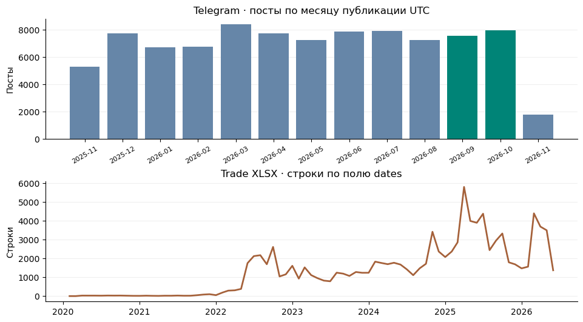
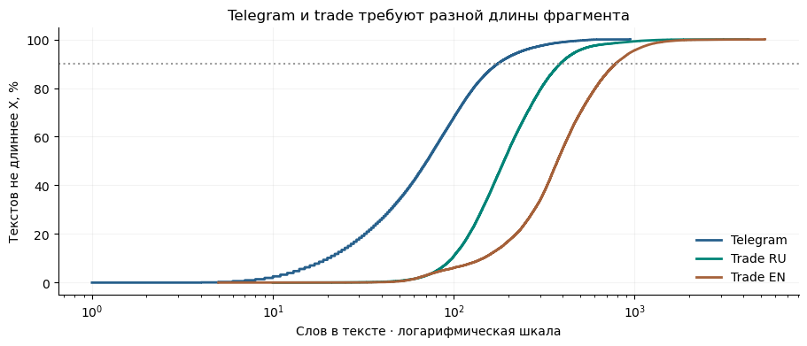
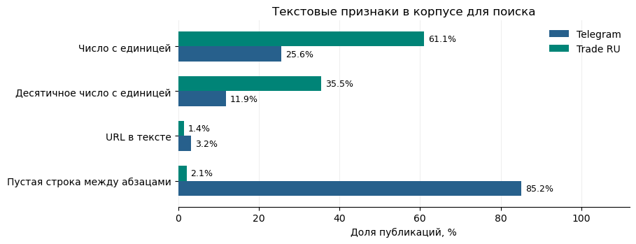
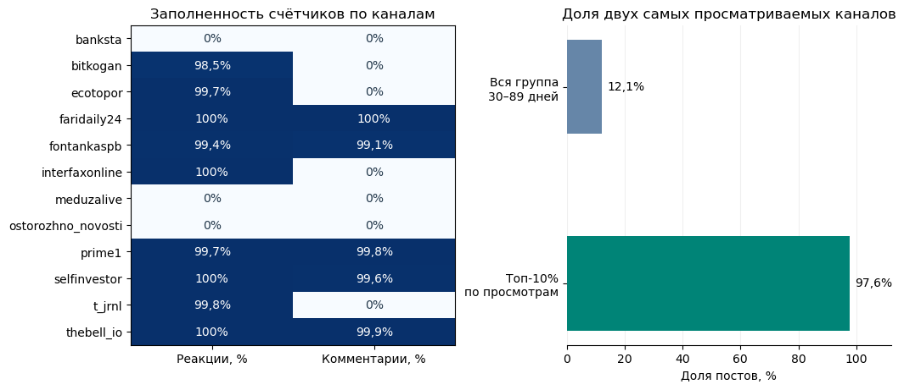
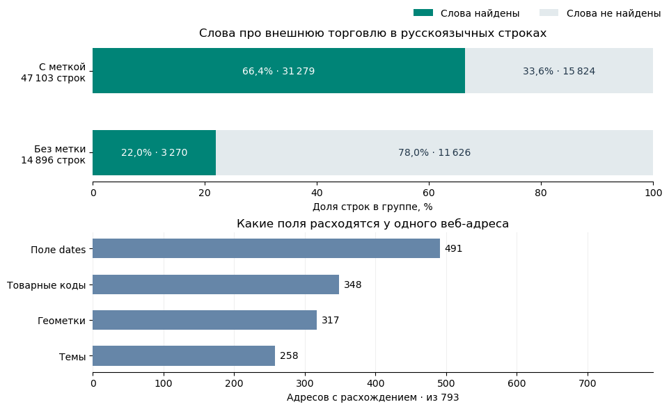

# EDA новостей для RAG

Telegram — годовая выгрузка постов из 12 каналов. Trade — собранные с веб-сайтов тексты торговых новостей, выгруженные в XLSX. Оба корпуса можно использовать для первого поиска после отбора. Длина, числа с единицами и повторяющиеся подписи подсказывают, как готовить текст к индексации.

[Ноутбук с расчётами](eda.ipynb) · [Манифест Telegram](../docs/reference/telegram_all12.json) · [Манифест Trade](../docs/reference/trade_news_full.json)

## Воспроизведение

Для запуска нужны снимки по путям из манифестов. Ноутбук проверяет SHA256 перед чтением. Сырые данные хранятся отдельно от Git. Сохранённые результаты можно посмотреть в ноутбуке и на графиках ниже.

Запуск из корня проекта в Python 3.13 с версиями пакетов, использованными при проверке:

```bash
python3.13 -m venv .cache/eda-reproduce
source .cache/eda-reproduce/bin/activate
python -m pip install pandas==2.3.3 matplotlib==3.10.6 lingua-language-detector==2.1.1 jsonschema==4.25.0 nbconvert==7.16.6 ipykernel==6.31.0
python -m ipykernel install --sys-prefix --name news-rag-eda
jupyter nbconvert --to notebook --execute --ExecutePreprocessor.kernel_name=news-rag-eda --ExecutePreprocessor.timeout=240 --output eda.executed --output-dir .cache/eda-run eda/eda.ipynb
```

## Состав и покрытие

| Выгрузка | Объём | Покрытие |
| --- | --- | --- |
| Telegram | 89 832 поста, 12 каналов | 09.11.2025–08.11.2026, UTC |
| Trade | 103 190 строк, 101 963 URI, 331 домен | 16.02.2020–11.06.2026 по полю `dates` |

В текущих файлах нет пустых текстов и повторных исходных ID. Telegram выгружался с фильтром по наличию текста, XLSX ранее прошёл техническую очистку. В Telegram Lingua оценила 99,26% постов как русскоязычные. В Trade 60,08% строк имеют исходную метку `ru`, 38,39% — `en`.



Сентябрь и октябрь — два последних полных месяца Telegram. На графике сырой экспорт. После удаления постов с одним хэндлом в этих месяцах остаётся 15 453 поста всех 12 каналов для разметки. График Trade показывает календарные метки `dates` неизвестного назначения.

## Как устроен текст



У 90% постов Telegram до 175 слов, у 90% Trade RU — до 388, у Trade EN — до 786. Длиннее 400 слов 1,1% постов, 9,0% русских и 44,9% английских статей. Для Telegram начнём с целых постов, для Trade сравним способы разбиения при одинаковом бюджете контекста.



Число с единицей нашли в 25,6% постов и 61,1% Trade RU. Это поиск по ограниченному набору единиц и обозначений масштаба. Пустая строка есть у 85,2% постов и 2,1% Trade RU, поэтому для веб-текста стоит проверить разбиение по предложениям. URL записан в тексте 3,2% постов, а поле `links` заполнено у 60,3% исходных постов. Это поле нужно хранить для атрибуции.

## Какие метаданные полезны для поиска

### Telegram · активность аудитории

Просмотры и пересылки записаны для всех 89 832 постов, реакции — для 49 399 (55,0%), комментарии — для 27 233 (30,3%). Заполненность зависит от канала.



Слева 0% означает, что для канала счётчик отсутствует в выгрузке. Справа среди 14 822 постов возрастом 30–89 дней «Осторожно, новости» и «Топор. Экономика» дают 12,1% записей и 97,6% постов в верхних 10% по просмотрам. Ранжирование только по просмотрам сконцентрировало бы выдачу на этих каналах.

### Trade · тема статьи и метки в таблице

«Внешняя торговля» — готовая метка в колонке `classes`. Мы отдельно проверили, встречаются ли в самом тексте слова «экспорт», «импорт» и формы выражения «внешняя торговля». Считали 61 999 русскоязычных строк XLSX.



Верхний график показывает 3 270 строк без метки, где есть совпадение по словам. Фильтр «показывать только статьи с меткой» исключит их из поиска. Поэтому стоит проверить метку как дополнительный сигнал ранжирования. Совпадение слов даёт кандидатов, а релевантность подтверждает разметка. На нижнем графике знаменатель для каждого поля — 793 адреса с повторными строками. Один адрес может учитываться в нескольких столбцах.

Пример из XLSX: у одного адреса текст совпадает, но в одной строке указана Австрия и товарный код `93`, а в другой — Австрия, Германия и коды `67`, `79`. В индекс кладём текст один раз, а метки сохраняем с ID исходных строк. Если в вопросе важна роль страны, сверяемся с текстом. [Веб-адрес из выгрузки](https://at.minpromtorg.gov.ru/news/?alias=20220912)

Товарные коды храним как текст, чтобы `01` сохранил ведущий ноль. В 15 718 строках есть такие коды. В поле `product` 26 076 пустых значений и 2 552 служебных маркера. При подготовке индекса их следует считать отсутствующим описанием товара.

## Отбор

| Выгрузка | Шаг | Осталось |
| --- | --- | ---: |
| Telegram | Исходные посты | 89 832 |
| Telegram | Исключены 4 поста, состоящие из одного хэндла | **89 828** |
| Telegram | Сентябрь и октябрь для разметки | 15 453 |
| Trade | Строки XLSX после прежней технической очистки | 103 190 |
| Trade | Один документ на URI | 101 963 |
| Trade | Исходная метка языка `ru` | 61 103 |
| Trade | Исключены 224 документа с текстом интерфейса, cookie или копирайта | **60 879** |

## Проблемы данных и решения

| Что показал EDA | Правило для RAG |
| --- | --- |
| Посты с одним хэндлом и веб-страницы без статьи | Исключать посты, где весь текст состоит из одного `@username`, и веб-записи, чей полный текст совпадает с одним из шести проверенных шаблонов. |
| Подписные хвосты у 43 342 Telegram-постов | Удалять из поискового текста только проверенные последние строки для соответствующего канала. Сохранять оригинал для цитирования. В пробе число постов с упоминаниями «Max» и «Макс» снизилось с 20 886 до 4 211. |
| Один текст в нескольких строках у 793 веб-адресов | Индексировать один текст на адрес. Сохранять метаданные с привязкой к исходной строке. В 491 группе расходится `dates`. |
| Перепечатки и одинаковые фразы о разных событиях | Проверять совпадение события, периода и первоисточника. Подтверждённую перепечатку считать одним свидетельством, сохраняя ссылки на публикации. |
| Промо, анонсы и подписи, смысл которых зависит от медиа | Исключать явное промо и служебные анонсы при отборе доказательств. Короткие посты оставлять, если в тексте есть самостоятельный факт. [Пример промо](https://t.me/selfinvestor/27381) · [Пример анонса](https://t.me/bitkogan/28629) |
| FTS5 теряет знак процента. Заголовки могут расходиться с текстом | Проверить отдельные поисковые признаки для числа, знака и единицы. Сверять факт и период с основным текстом. В одном заголовке рост пошлины указан как 1,5%, в статье — 52,3%. [Пример Интерфакса](https://www.interfax.ru/business/867929) |
| У Trade неизвестен смысл `dates`. Telegram хранит наблюдённую редакцию | Использовать `dates` для анализа покрытия. Для исторического ответа проверять, что конкретная версия была доступна к моменту вопроса. При необходимости подтверждать её архивной копией. |

## Доказательства для ответа

Между выгрузками обнаружены 35 пар по ссылкам и 198 по общим фрагментам русскоязычного Trade. Семь пар найдены обоими способами, всего 226 кандидатов. [Пост о расчётах](https://t.me/interfaxonline/73062) · [Статья Интерфакса](https://www.interfax.ru/business/1090465)

У 59 485 постов Telegram есть метка последней правки. Текущие версии наблюдались 8 ноября 2026 года по UTC, поэтому запросы к более ранним датам требуют дополнительных источников версий.

В пробе FTS5 запросы `85%` и `85` вернули одни и те же 148 постов, в 25 из них есть самостоятельное значение 85%. Сравнить BM25 и Hybrid на размеченных вопросах при одном снимке и одинаковых правилах отбора. Затем по отдельности проверить добавление числовых признаков и меток Trade. Измерять Recall@k по доказательствам и сохранность чисел, единиц и источников.

<details>
<summary>Что означают поля выгрузок</summary>

### Trade XLSX

| Поля | Что хранят |
| --- | --- |
| `id`, `url`, `text` | ID строки, адрес материала и текст для поиска и цитирования |
| `title`, `title_en`, `title_orig_lang` | Аннотация и варианты заголовка. Их пригодность для поиска и ответа проверяем отдельно |
| `orig_lang`, `dates` | Исходная метка языка и календарная метка неизвестного назначения |
| `classes`, `classes_en` | Темы материала |
| `itc_codes`, `itc_codes_en`, `product` | Коды и описания товаров. У `product` смешанные форматы |
| `locations`, `locations_en`, `status` | География и служебная метка. Повторы проверяем по URI и тексту |

### Telegram JSONL

| Поля | Что хранят |
| --- | --- |
| `id`, `source`, `url`, ID канала и сообщения | Ключ поста, источник и ссылку на цитату |
| `text`, `language`, `media_type`, `grouped_id` | Текст или подпись, тип вложения и ID альбома. Поле языка в выгрузке пустое |
| `published_at`, `edited_at`, `observed_at` | Время публикации, последней правки и наблюдения сохранённого текста |
| `links`, `forwarded_from`, ответы и счётчики | Ссылки, происхождение, ветку обсуждения и вовлечение |

</details>
